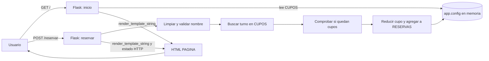
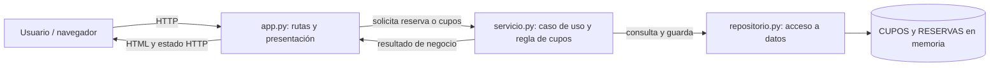

# Entrega de la actividad: reserva de menú en MVC y capas

Este documento registra el análisis del estado inicial, el refactor realizado y su verificación. `ACTIVIDAD.md` conserva las instrucciones originales.

## 1. Mapa del estado inicial

Antes del cambio, `app.py` contenía el HTML (`PAGINA`), las rutas, la validación, la regla de cupos y el acceso a las colecciones.



| Caso | Decisión inicial en la ruta | Respuesta observable |
| --- | --- | --- |
| Nombre de menos de 2 caracteres tras quitar espacios | Rechazar sin consultar ni modificar reservas | 400; mensaje de nombre inválido |
| Turno inexistente | Rechazar sin crear reserva | 404; `El turno no existe.` |
| Cupos agotados | Rechazar sin crear reserva | 409; `No quedan cupos.` |
| Reserva válida | Reducir el cupo en uno y agregar la reserva | 201; confirmación con el nombre limpio |

La página inicial responde 200 y muestra dos cupos para almuerzo. La validación del atributo HTML `required` ayuda en el navegador, pero la validación efectiva ocurre también en el servidor.

## 2. Diagrama de la arquitectura aplicada



**Dirección de dependencias:** `app.py` importa `ServicioReservas` y `RepositorioReservasMemoria` para conectarlos; `servicio.py` usa el repositorio; `repositorio.py` no conoce Flask. El servicio devuelve un resultado de negocio (`EstadoReserva`), y la ruta lo traduce a texto y código HTTP. `tests/test_servicio.py` importa solo el servicio y el repositorio.

**Capas lógicas:** presentación y controlador (`app.py`), caso de uso (`servicio.py`) y acceso a datos (`repositorio.py`). El HTML sigue como cadena en `app.py`, suficiente para el alcance de esta práctica. **Nivel físico:** todo corre en un solo proceso Flask. El navegador es un cliente separado que se comunica por HTTP; el repositorio en memoria no es una base de datos ni otro servidor. Separar archivos no implica desplegar niveles físicos adicionales.

## 3. Refactor y comportamiento conservado

- La ruta recibe `nombre` y `turno`, llama al servicio y prepara la respuesta. Ya no decide si hay cupos ni modifica `RESERVAS`.
- El servicio limpia y valida el nombre, distingue turno inexistente y cupos agotados, y ordena guardar una reserva válida.
- El repositorio consulta cupos y actualiza `CUPOS` y `RESERVAS` en memoria.
- `crear_app()` construye colecciones nuevas por aplicación. Se mantienen las mismas rutas, formulario, mensajes y estados HTTP. Los datos vuelven a dos cupos al reiniciar la aplicación.

### Registro: predicción → cambio → prueba → resultado

| Predicción | Cambio | Prueba | Resultado |
| --- | --- | --- | --- |
| Separar la regla no debe alterar la página inicial ni los estados HTTP | La ruta delega en `ServicioReservas` | Cinco pruebas originales en `tests/test_app.py` | Pasaron: 5 de 5 |
| Un nombre inválido no debe consumir cupo | Validación en el servicio | `test_nombre_invalido_no_consume_cupo` | Pasó; cupo 2, ninguna reserva |
| Una reserva válida debe consumir exactamente un cupo | Guardado en el repositorio | `test_reserva_valida_reduce_un_cupo_y_guarda_nombre_limpio` | Pasó; cupo 1 y una reserva |
| Sin cupos o con turno inexistente no debe guardarse nada | Decisiones en el servicio | Dos pruebas directas del servicio | Pasaron; ninguna reserva |

Comando ejecutado desde la raíz del proyecto:

```powershell
.\.venv\Scripts\python.exe -m unittest discover -s tests -v
```

Resultado final: **9 pruebas aprobadas** (5 originales y 4 del servicio). No se modificaron las pruebas originales.

## 4. Criterios de aceptación

| Criterio | Evidencia |
| --- | --- |
| Nombre inválido sin consumir cupo | Pruebas web y de servicio |
| Reserva válida reduce el cupo exactamente en uno | Pruebas web y de servicio |
| Sin cupos no crea reserva | Pruebas web y de servicio |
| La ruta no contiene la regla de cupos ni modifica reservas | Regla en `servicio.py`; escritura en `repositorio.py` |
| Servicio probado sin Flask ni HTTP | `tests/test_servicio.py` |
| Capas lógicas y nivel físico explicados | Diagrama y explicación de la sección 2 |
| Pruebas originales conservadas | `tests/test_app.py` sin cambios |

## 5. Guía para la defensa individual

Cada integrante debe poder explicar cualquiera de las cuatro filas del mapa inicial y ubicar su decisión actual. Ejemplo para **sin cupos**: la ruta entrega nombre y turno al servicio; el servicio obtiene los cupos del repositorio; si son cero, devuelve `SIN_CUPOS` sin guardar; la ruta presenta `No quedan cupos.` con HTTP 409. La prueba directa verifica que `RESERVAS` permanezca vacía.

**Variante posible del docente:** si mañana el máximo inicial cambia de dos a tres, se modifica la inicialización en `crear_app()` y se actualizan las pruebas que dependen de ese valor. Si cambia la *regla* para permitir o denegar reservas según otra condición, se modifica `ServicioReservas` y se ejecutan primero sus pruebas unitarias; después las pruebas web para comprobar que la respuesta pública se mantiene o cambia según lo solicitado.

**Salida individual, en dos minutos:** “Espero modificar `servicio.py` si cambia la regla de cupos, porque allí se decide si una reserva se acepta. Ejecutaría primero `tests/test_servicio.py`, que comprueba la decisión sin depender de Flask, y luego todas las pruebas para confirmar la respuesta web”.

## 6. Registro de trabajo en pareja y uso de IA

La lectura individual previa, el cambio de roles, la conversación de la pareja y la defensa oral son actividades personales. No se registran aquí como realizadas. Completar durante la sesión:

| Punto | Registro de la pareja |
| --- | --- |
| Recorrido individual de integrante 1, antes de conversar o usar IA | Pendiente |
| Recorrido individual de integrante 2, antes de conversar o usar IA | Pendiente |
| Primera ronda sin IA y propuesta acordada | Pendiente |
| Constructor/a inicial y verificador/a inicial | Pendiente |
| Momento del cambio de roles | Pendiente |
| Pregunta posterior hecha a IA | “Revisa este proyecto y hazme un diagrama de cómo está armado y su arquitectura”; después se pidió realizar los entregables de `ACTIVIDAD.md` en otro Markdown. |
| Aportes de IA aceptados por la pareja y evidencia | Pendiente de revisión por la pareja; el código y las nueve pruebas están disponibles para verificarlo. |
| Aportes de IA rechazados y motivo | Pendiente de revisión por la pareja |

Si el docente indica una ronda de intercambio, revisen el mapa de otra pareja y escriban una observación comprobable, por ejemplo: “`test_sin_cupos_no_guarda_reserva` muestra que el servicio no crea una reserva cuando el cupo es cero”. La revisión de otra pareja queda pendiente hasta que ocurra.
